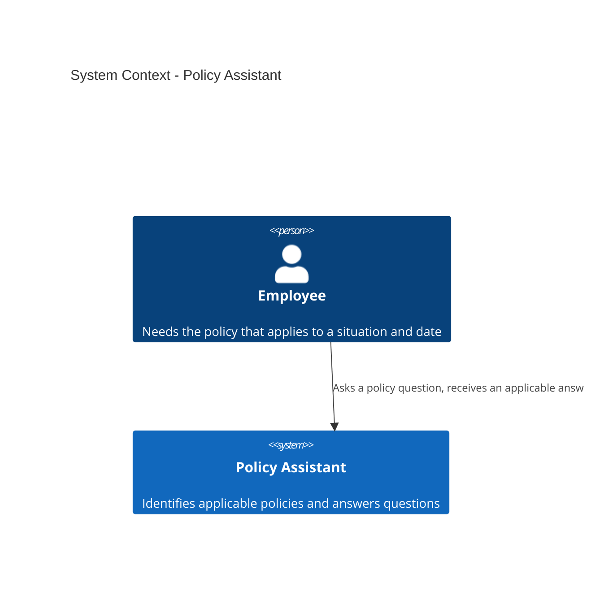
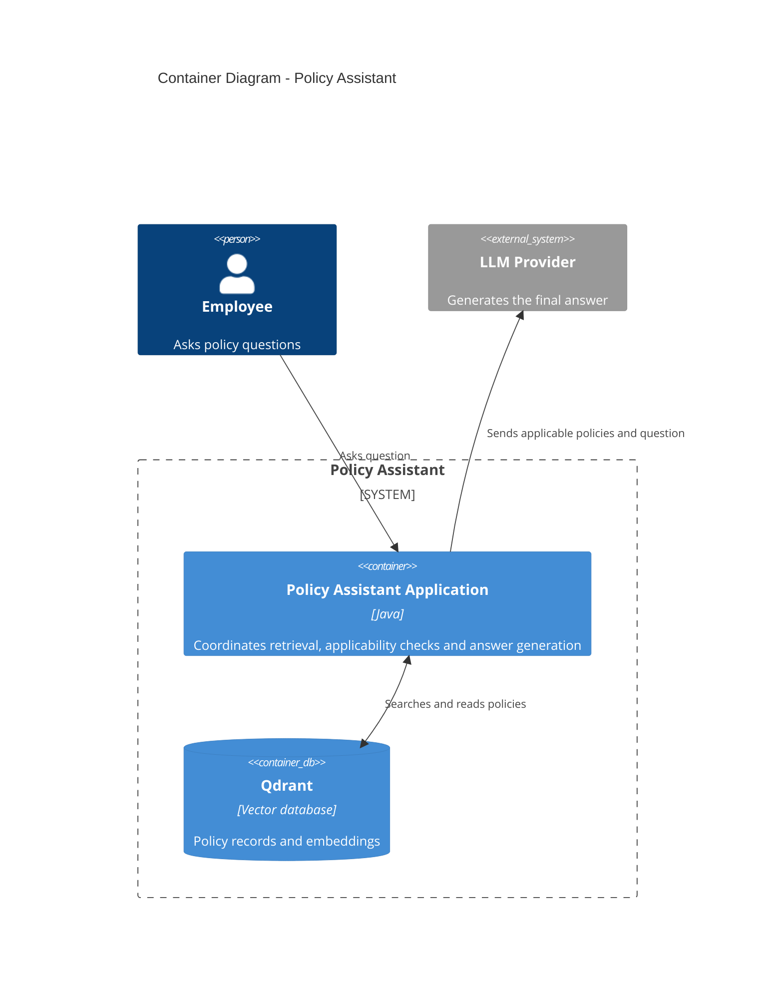
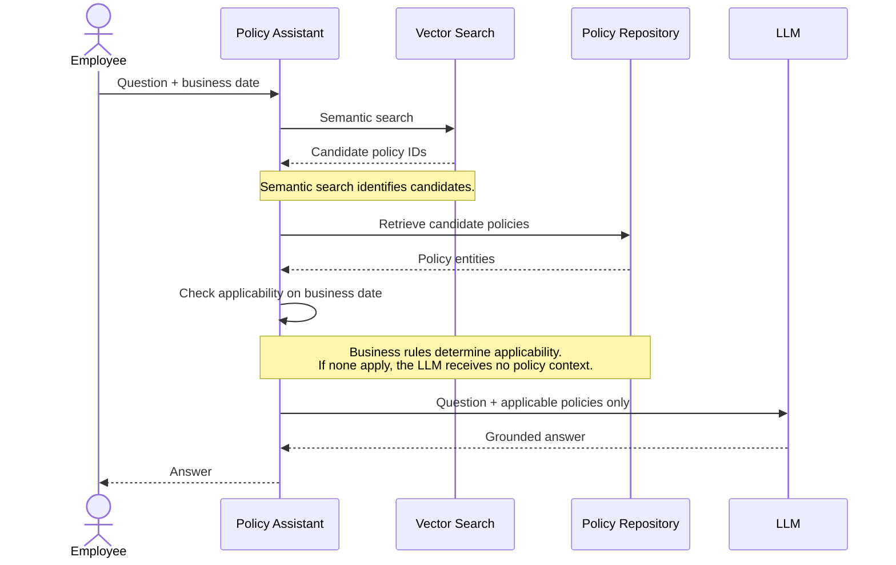
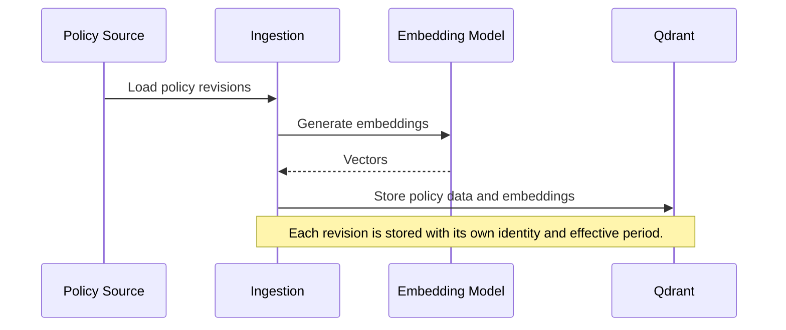

# jnosql-langchain4j-rag-se

A Java SE example of Retrieval-Augmented Generation (RAG) that combines
**LangChain4j**, **Eclipse JNoSQL**, and **Qdrant** as the single database.
It demonstrates versioned, domain-aware retrieval: semantic search finds candidate
policies, and domain rules decide which of them apply.

> All policies, deadlines and dates in this project are **fictional examples**, not real
> financial regulations.

**Central lesson:** semantic relevance identifies candidate knowledge, while domain
rules determine which knowledge is applicable.

## Why Two-Stage Retrieval?

An employee needs to know which financial policy applies to a particular situation and
business date. Policy revisions can be semantically almost identical yet have different
effective periods, so similarity alone cannot say which one is valid.

Two-Stage Retrieval separates the concerns: **semantic search identifies candidate
policies; business rules establish which of them apply.** Only applicable policies reach
the language model.

## Architecture

### System Context — C4 Level 1



The Policy Assistant helps employees identify the policies applicable to a specific business situation and date.

### Container Architecture — C4 Level 2



### Two-Stage Retrieval — Sequence Diagram



### Policy Ingestion — Sequence Diagram



### Architectural Decisions and Trade-offs

| Decision | Rationale |
|---|---|
| Two-stage retrieval | Semantic similarity identifies candidates; domain rules establish applicability. |
| One Qdrant database | Policy entities and vectors share the same persistent storage. |
| Persistence abstraction | Jakarta Data and Eclipse JNoSQL give familiar Java access to policy entities without database-specific APIs in the business logic. |
| Immutable policy revisions | Historical versions are preserved, and effective dates determine applicability. |
| Explicit business date | The business context is provided explicitly, not inferred from natural language. |

Production considerations (candidate recall, access control, database-side filtering) are
covered under [How the business date reaches the retriever](#how-the-business-date-reaches-the-retriever).

## Requirements

Java 21, Maven, Docker, and an OpenAI API key (only to run the application).

## Start Qdrant

```bash
docker compose up -d     # gRPC on 6334, HTTP on 6333
docker compose down      # stop
```

## Configure the API key

The key is read from the `RAG_CHAT_API_KEY` environment variable, which
MicroProfile Config resolves as `rag.chat.api-key`. It is never stored in
`microprofile-config.properties`.

```bash
cp .env.example .env
# edit .env and replace the placeholder with your key
```

`.env` is git-ignored; only `.env.example` is tracked. Java does not load `.env`
files by itself, so `scripts/run.sh` sources it with `set -a`. **`.env` is executed
as shell code: treat it as trusted local configuration and never put untrusted
commands in it.**

**IntelliJ IDEA:** open *Run | Edit Configurations*, select the `App` configuration,
and add `RAG_CHAT_API_KEY=<your key>` under *Environment variables*.

## Reset the development collection

The collection must be recreated once after upgrading from the earlier, unversioned
sample data (existing ids are skipped, never updated). This is a destructive,
development-only step that is never run by the application, tests or build:

```bash
./scripts/reset-qdrant.sh    # asks for confirmation; uses QDRANT_URL (default http://localhost:6333)
```

It deletes only the `policies` collection and recreates it (384 dimensions, cosine).
Other collections and the Docker volume are untouched. The next application start
inserts the four policy records.

## Run the application

```bash
./scripts/run.sh            # Demo 1: Eclipse JNoSQL VectorTemplate (default)
./scripts/run.sh data       # Demo 2: Jakarta Data repository
```

The script validates the key and runs `mvn compile exec:java` (main class chosen via `-Ddemo.main`), preserving its exit code.

## Two demos, one entity

Both demos run the same three scenarios against the same `policies` collection. LangChain4j does semantic discovery in both (Jakarta Data repositories in JNoSQL 1.2.0 have no vector similarity query); they differ in how entities are persisted and fetched.

| Package | Demo 1 – `template` | Demo 2 – `data` |
|---|---|---|
| Entry point | `app.App` | `app.DataApp` |
| Persistence | `VectorTemplate` | `PolicyRepository` (`@Repository`, `CrudRepository<Policy, UUID>`) |
| Existence check / fetch | `VectorTemplate.find` | derived `existsById` / `findByIdIn` |

Packages: `model` (the shared `Policy` entity), `template` and `data` (loader, retriever, assistant per demo), `shared` (prompts, response record, JSON definitions, scenarios, context formatting), `infra` (LangChain4j CDI producers, date converter), `app` (entry points).

## Run tests

```bash
mvn test      # unit tests, no external services
mvn verify    # also runs Qdrant integration tests (needs Docker, no OpenAI key)
```

The integration tests start their own Qdrant Testcontainer and use a stub chat model,
so no OpenAI key is needed. They verify persistence through JNoSQL, that LangChain4j
and JNoSQL share the `policies` collection, the revision selected per business date,
and that only applicable policies reach the model prompt. Live LLM output is not
asserted because it is non-deterministic.

## Policy revisions and temporal applicability

- Policies are **immutable revisions**. Each revision has its own UUID (`id`); the stable
  business identity shared by revisions is `policyCode` (e.g. `CARD-DISPUTE`).
- A revision applies from `effectiveFrom` (inclusive) until `effectiveUntil` (exclusive);
  a null end means open-ended. `Policy.appliesOn(LocalDate)` implements this.
- `policies.json` has four records: Card Dispute v1.0 (30 days, until 2026-07-01), Card
  Dispute v2.0 (60 days, from 2026-07-01), Fraud Investigation and Identity Verification.
- Embeddings are generated from title and content only, never stored in JSON.
- `PolicyLoader` inserts a record only if its UUID is missing and never updates existing
  ones. To change a published policy, add a new revision with a new UUID.
- Storage note: JNoSQL writes null fields as null payload values, which LangChain4j's
  Qdrant store cannot read. An open-ended period is therefore persisted with the
  `9999-12-31` sentinel (`OpenEndedDateConverter`) and read back as `null`.

## How the business date reaches the retriever

The date is explicit, typed input. `PolicyAssistant.analyze(question, InvocationParameters)`
receives a LangChain4j `InvocationParameters` carrying a `LocalDate` under `businessDate`;
LangChain4j exposes it to `PolicyRetriever` as `query.metadata().invocationParameters()`.
Dates are never parsed from the question text, and a missing date is an error.

For this small demo the candidate count (`rag.search.max-results=10`) covers all
revisions. Production systems should consider database-side filters, authorization and
candidate recall, and should not treat similarity scores as probabilities.

## Demonstration scenarios

`./scripts/run.sh` runs three scenarios and prints the question, business date, answer,
human-review flag and recommendations:

1. **Historical policy** (2026-05-15): a report 20 days after a May 2026 purchase uses
   Card Dispute v1.0 (30 days).
2. **Current policy** (2026-08-15): a report 45 days after an August 2026 purchase uses
   v2.0 (60 days), so it is within the period.
3. **Insufficient knowledge**: an international wire-transfer reversal is not covered by
   any policy. Similar card policies may be retrieved, but similarity is not evidence;
   the assistant must say so, require human review and not invent a deadline.
